# DUSHANBE-X — отчёт о разработке и тестировании (версия 0.1.0)

## 1. Среда и инструменты

| Инструмент | Использование |
|---|---|
| Godot 4.4.1 (официальная сборка) | движок, рендер **Mobile** (Vulkan) с откатом на OpenGL ES 3, физика Jolt |
| Шаблоны экспорта 4.4.1, Android SDK (build-tools 34, platform 34), OpenJDK 21 | сборка и подпись APK |
| Mesa lavapipe (программный Vulkan) + Xvfb | рендер скриншотов без GPU (≈1–5 кадр/с — только для проверки) |
| Python 3 + numpy/scipy/Pillow | генерация рельефа, дорог, зданий, полей, текстур, звуков |

Blender и готовые 3D-ассеты не использовались: все модели (рельеф, дороги, мосты, тоннель, здания,
достопримечательности, деревья, машины, персонажи) построены программно в 3D через `MeshKit`.
OpenStreetMap (Overpass API) из среды недоступен — раскладка сделана по известной географии города.

## 2. Что проверено и как

| Проверка | Метод | Результат |
|---|---|---|
| Синтаксис/загрузка всех скриптов | headless-запуск полной игры (`--quit-after 900`) | 0 ошибок скриптов |
| Сборка APK | `--export-debug "Android"` | APK собран, подписан, проверен `apksigner` |
| Содержимое пакета | экспорт PCK с фильтрами Android и запуск PCK отдельно от проекта | мир загружается за ~0.4 с, 0 ошибок |
| Рельеф без разрывов | авто-проверка генератора: макс. перепад между соседними клетками | после исправлений ≤ 38.7 м/5 м только на скальных пиках > 2200 м; дороги не добавляют обрывов |
| Мосты/тоннель | генератор: 29 мостов, 1 тоннель 520 м; рендер | см. скриншоты |
| Физика машин | тест модуля транспорта (Jolt, headless) | Рудаки 557 м, серпантин +72.7 м (~14 %), Варзоб +21 м; машины не переворачиваются и не проваливаются |
| Персонаж | тест модуля персонажей | ходьба 8.3 м, подъём на бордюр 0.15 м, прыжок 1.15 м, удар/присед/анимации |
| Игровой цикл | `--gameshots`: спавн → посадка в машину → газ → ночь | персонаж, HUD, вождение 40 км/ч, фары, окна и фонари ночью |
| Скриншоты | `--shots` с камер по всему миру | `docs/screenshots/` |

## 3. Производительность (оценка)

Измерено в режиме `--gameshots` с профилировщиком по системам (`scenes/main.gd::_profile`),
центр Душанбе у площади Дусти, пресет «Средний», 960×540. FPS в этой среде не показателен
(программный рендер на CPU), поэтому оптимизация велась по числу треугольников и вызовов отрисовки.

| Этап | Вызовы отрисовки | Примитивы в кадре (с тенями) |
|---|---|---|
| До оптимизации (пресет «Высокий») | 619–845 | 2.5–3.0 млн |
| После оптимизации («Средний») | 546 | 1.36 млн |

Что сделано:
* промежуточный LOD зданий (балконы и детали только в радиусе 160 м), дальние здания — одна поверхность на сектор;
* объединение материалов в зданиях, дорогах, пропсах (`MeshKit.slot_remap`);
* прореживание дальних деревьев (в 2 раза, компенсация размером кроны), ближние — только 130 м;
* тени только у LOD0 рельефа и ближних объектов, у дорог теней нет;
* колёса и стоп-сигналы машин трафика скрываются дальше 110–150 м;
* окклюдеры (`BoxOccluder3D`) для зданий от 4 этажей;
* коллизии рельефа, дорог, зданий — только в радиусе 180–300 м от игрока.

Оценка для устройств: пресет «Низкий» (дальность 2.5 км, масштаб рендера 0.6, без теней и травы) ориентирован на
бюджетные устройства; «Средний» — на среднеуровневые (Adreno 6xx / Mali-G7x). **Реальные FPS на телефоне
не измерялись** — в среде нет Android-устройства или эмулятора с аппаратным ускорением.

## 4. Галерея (рендер в Godot, пресет «Высокий»)

| | |
|---|---|
| 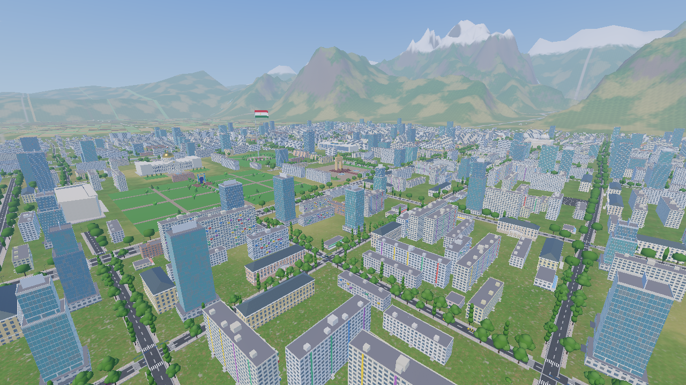 центр Душанбе | 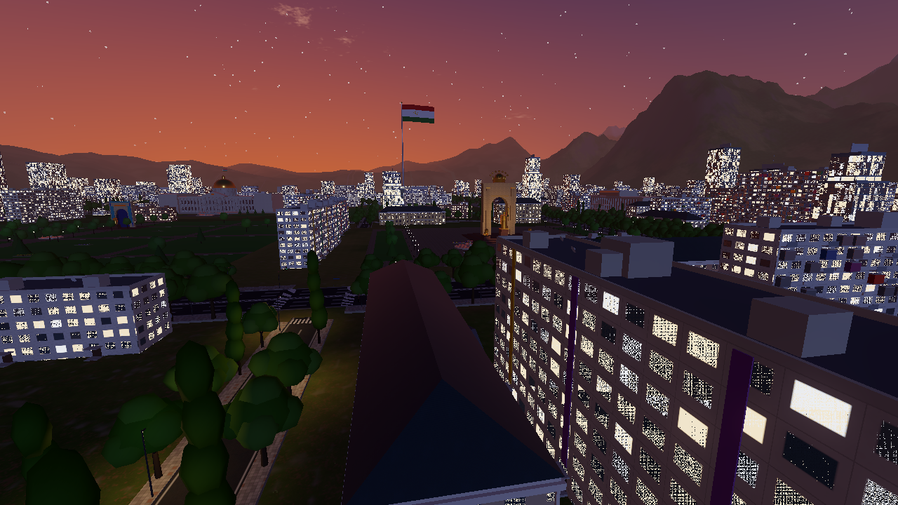 площадь Дусти в сумерках |
| 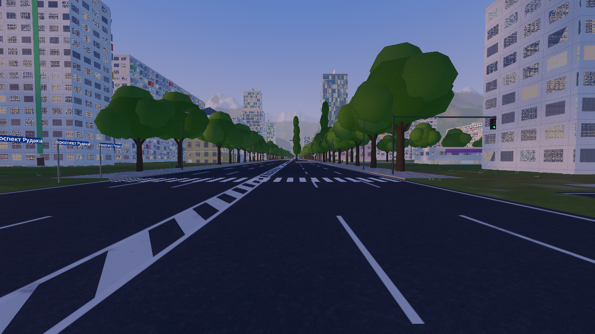 проспект Рудаки | 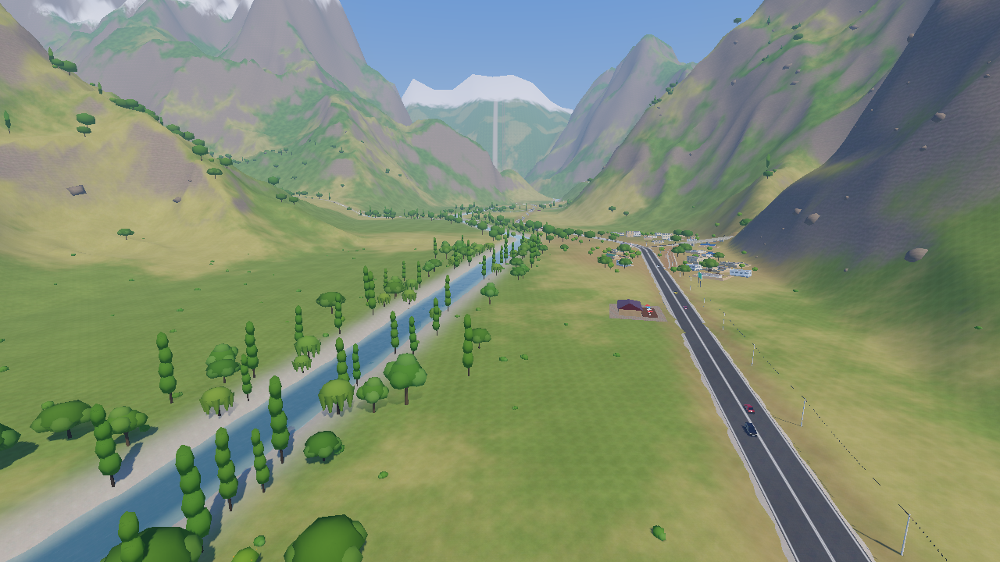 Варзобское ущелье |
| 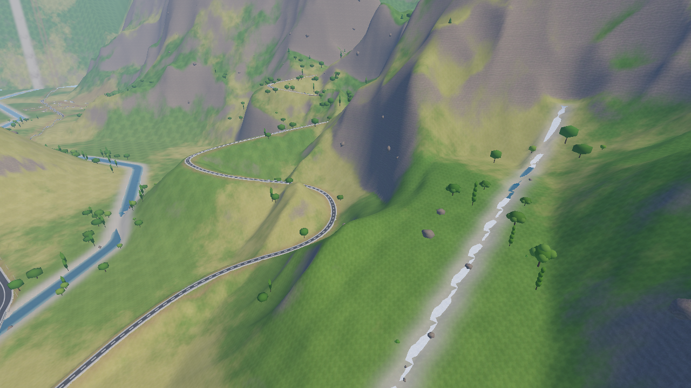 серпантин и водопад Гусгарф | 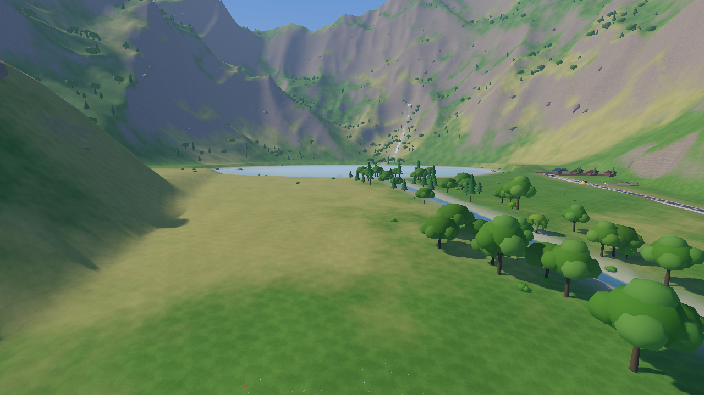 озеро Кули Сабз |
| 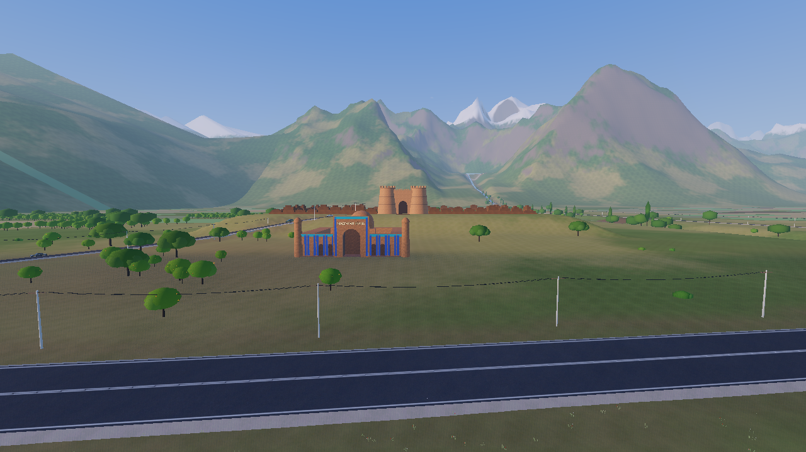 Гиссарская крепость и медресе | 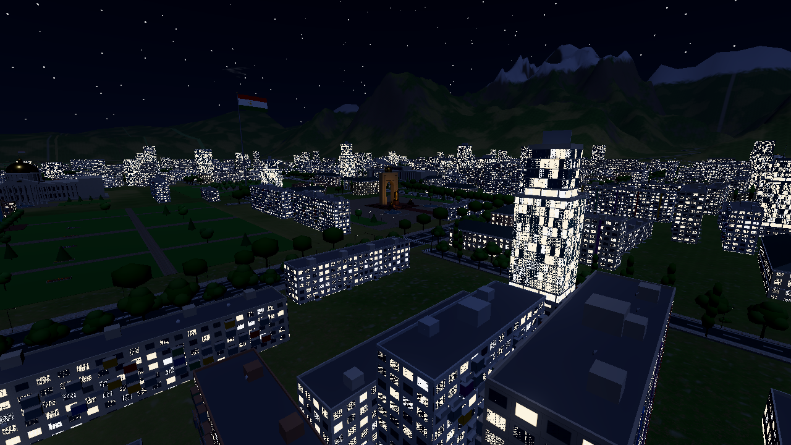 ночной город |
| 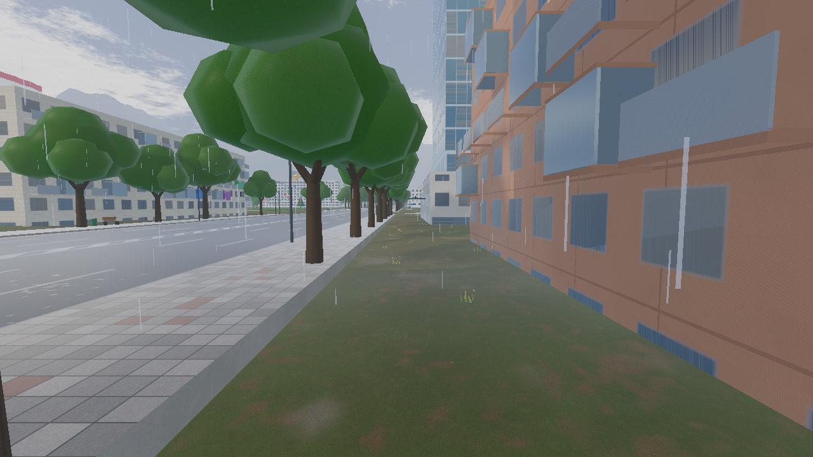 дождь, мокрый асфальт | 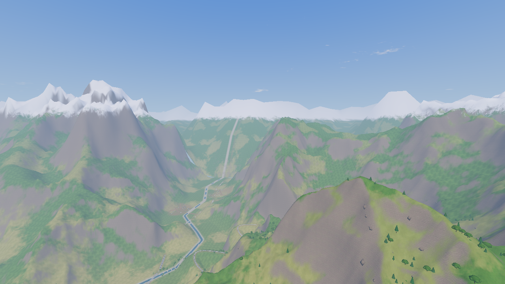 снежные вершины |
| 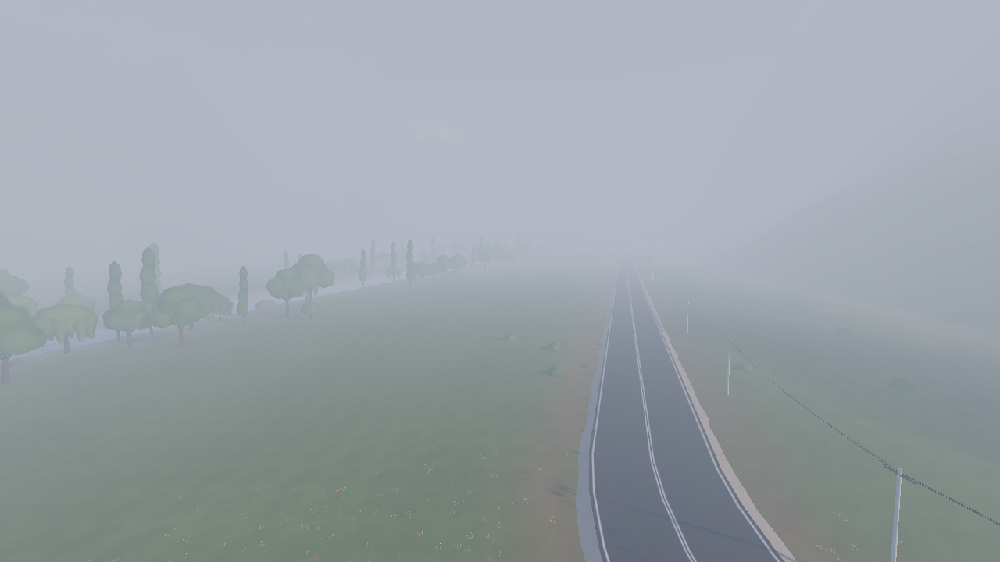 утренний туман | 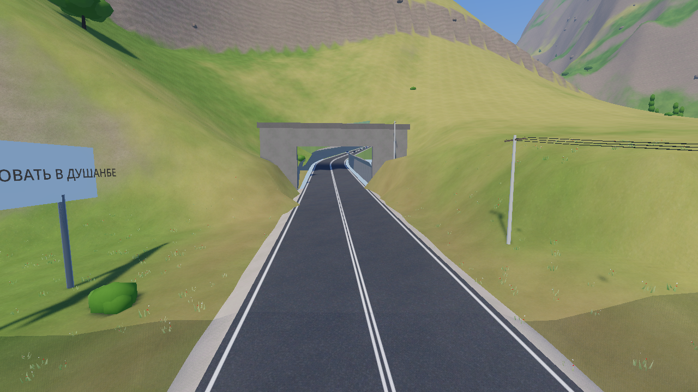 портал тоннеля |
| 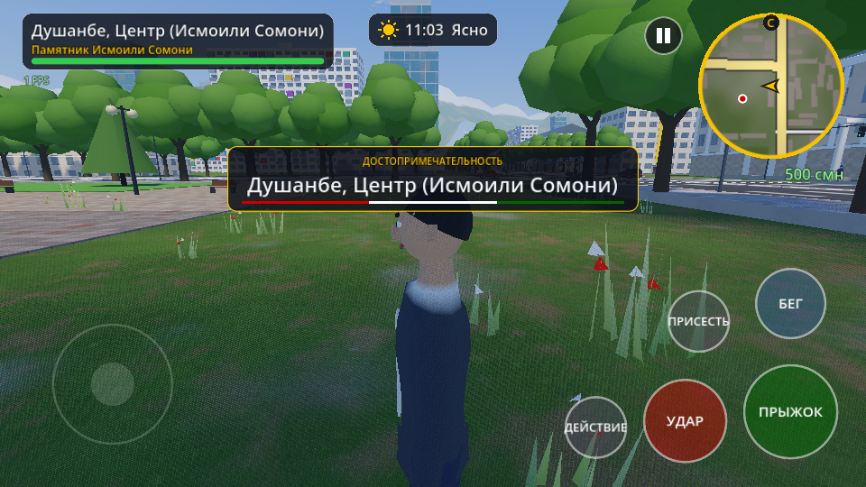 игрок и HUD | 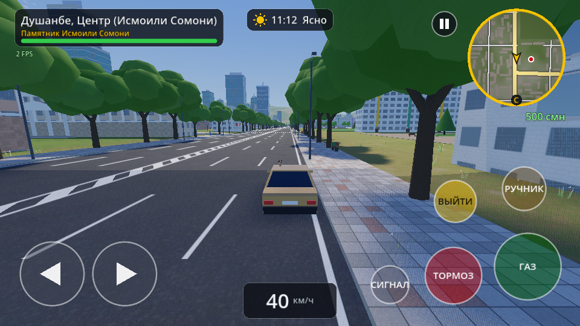 вождение |

Дополнительно: `landmarks_*.png` (все достопримечательности), `character_*.png`, `vehicles_*.png`, `ui_*.png`.

## 5. Сборка APK

* `build/DUSHANBE-X-0.1.0-debug.apk` — 52 МБ, пакет `tj.dushanbex.game`, версия 0.1.0 (code 1),
  arm64-v8a, targetSdk 34, подпись debug-ключом (схемы v2+v3), `apksigner verify` — успешно.
* Содержимое пакета проверено запуском экспортированного PCK отдельно от проекта: мир загружается, ошибок нет.
* **На реальном Android-устройстве APK не запускался** (в среде нет устройства/эмулятора). Первый запуск
  на телефоне — следующий обязательный шаг: проверить FPS по пресетам, нагрев, сенсорное управление.

## 6. Известные ограничения

* Реки и озёра визуальные: плавания нет, под водой можно идти по дну.
* Полиция преследует напрямую, без поиска пути по дорогам; ИИ-машины не соблюдают светофоры.
* Пешеходы не обходят друг друга; нет навмеша.
* Статуи и львы стилизованные (собраны из простых форм); персонаж низкополигональный —
  скелет совместим с `SkeletonProfileHumanoid`, модель можно заменить на .glb (см. `characters/README.md`).
* Карта сжата по сравнению с реальной (расстояния ~в 2–3 раза меньше), это игровая интерпретация.
* Release-подпись требует ключа владельца; в репозитории собирается debug-APK.
