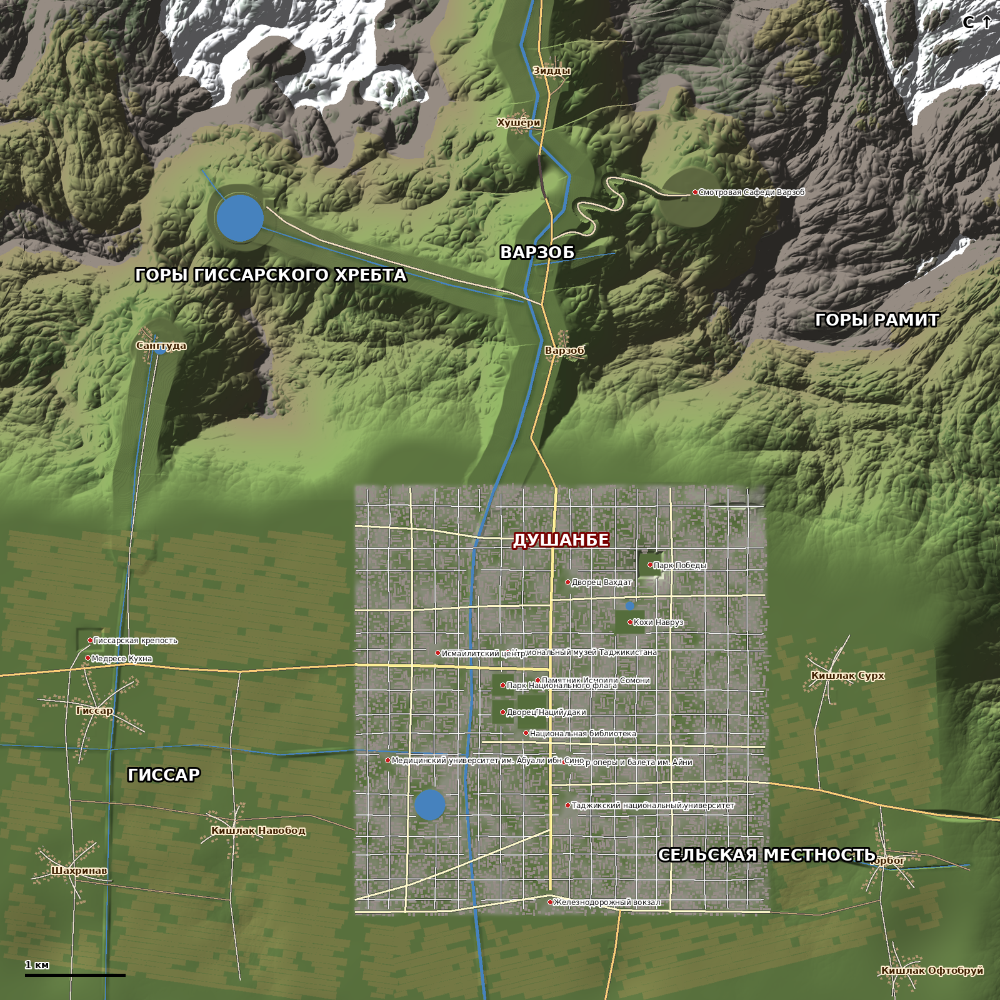

# DUSHANBE-X — дизайн игрового мира (этап 1)

## Источники и подход

Сервис Overpass API (OpenStreetMap) из среды разработки недоступен (прокси сбрасывает соединение),
поэтому раскладка построена по общеизвестной географии Душанбе и окрестностей:

* проспект Рудаки — главная ось города, идёт с севера на юг; площадь Дусти с памятником Исмоили Сомони,
  парк Рудаки, Дворец Наций, парк Национального флага, Национальный музей и Национальная библиотека
  образуют центральный ансамбль; театр Айни стоит на Рудаки;
* река Душанбинка (Варзоб) течёт с севера, из Варзобского ущелья, вдоль западной части центра;
* к северу — Гиссарский хребет и Варзобское ущелье с трассой на север (тоннель, кишлаки, водопад Гусгарф);
* к западу — Гиссарская долина с крепостью и медресе, хлопковыми и пшеничными полями;
* к востоку и югу — сельская местность с садами, виноградниками и каналами.

Расстояния сжаты примерно в 2–3 раза, чтобы уложить регионы в 100 км² и сохранить плотность событий.
Карта — оригинальная игровая интерпретация, а не копия.

## Масштаб и регионы (10 × 10 км, клетка рельефа 5 м)

| Регион | Площадь (≈) | Высоты | Содержание |
|---|---|---|---|
| Душанбе | 16.6 км² (4.1 × 4.3 км) | 5–40 м | 5 районов, сетка улиц, 5300+ зданий 7 типов, 17 достопримечательностей |
| Варзоб | ≈18 км² | 25–330 м дно ущелья | река, трасса, тоннель 520 м, 3 кишлака, водопад Гусгарф, кафе, турбазы |
| Горы (Гиссарский хребет, Рамит) | ≈35 км² | до 2185 м | хребты, снежники выше ~1450 м, озеро Кули Сабз (457 м), котловина Сафеди Варзоб (518 м) |
| Гиссар | ≈15 км² | −5–25 м | крепость, медресе, Гиссар, Шахринав, Навобод, участки полей, канал |
| Сельская местность | ≈14 км² | 0–90 м | Сурх, Чорбог, Офтобруй, сады абрикосов, виноградники, канал Чорбог |

## Районы Душанбе

* **Исмоили Сомони** (север): Дворец Вахдат, Кохи Навруз, Парк Победы на холме.
* **Центр**: площадь Дусти, памятник Сомони, парк Рудаки, Дворец Наций, парк флага, музей, библиотека, театр Айни, ТНУ.
* **Фирдавси** (северо-запад, за рекой): Исмаилитский центр, улица Фирдавси.
* **Сино** (юго-запад): медуниверситет им. Сино, Комсомольское озеро, проспект Сино.
* **Шохмансур** (восток): рынок Мехргон, частный сектор (хавли) на окраинах.

## Дорожная сеть (196 км)

| Класс | Длина | Ширина | Особенности |
|---|---|---|---|
| Проспекты (Рудаки, Сомони) | 6.0 км | 24 м, 6 полос | штрихованная разделительная, тротуары 5 м, фонари с двух сторон |
| Бульвары (Шерози, Турсунзаде, Айни, Фирдавси, Сино, Навои…) | 25.8 км | 16 м, 4 полосы | двойная осевая, тротуары 4 м |
| Городские улицы | 113 км | 9 м | сетка ~225×205 м, мосты через реку на каждой третьей улице |
| Трассы (Варзоб, Гиссар, Восточная, Курган-Тюбе) | 11.8 км | 14 м | отбойники над обрывами, ЛЭП, щиты, км-столбы |
| Горные (серпантин Сафеди Варзоб, дорога на Кули Сабз) | 5.4 км | 8 м | уклоны до ~15 %, 14 шпилек, отбойники |
| Сельские / грунтовые | 33 км | 6.4 / 5.2 м | изношенный асфальт, колеи |

* 372 перекрёстка (из них 120 со светофорами), 1276 пешеходных переходов.
* 25 мостов (через Душанбинку, ручьи и каналы) — плита, парапеты, опоры, устои.
* 1 тоннель (520 м) сквозь скальный отрог в Варзобском ущелье — свод, освещение, порталы.
* Профиль каждой дороги рассчитан генератором: сглаживание рельефа, ограничение уклона, подъём на мосты,
  выемки/насыпи с откосами ~35°, совпадение высот на перекрёстках.

## Расстояния (по прямой)

* Памятник Сомони → кишлак Варзоб: 3.3 км; → Гиссарская крепость: 4.5 км; → Сафеди Варзоб: 5.1 км.
* Трасса Душанбе — Варзоб: 5.0 км, подъём 300 м. Серпантин: 2.5 км, подъём 363 м.
* Дорога на Кули Сабз: 2.9 км, подъём 345 м.

## Вода

* Душанбинка/Варзоб (24 м), ручьи Кули Сабз, Гусгарф, Сангтуда, Гиссарский канал, канал Чорбог.
* Уровень воды вдоль русла монотонно убывает по течению; на крутых участках — водопады (4 участка).
* Озёра: Кули Сабз (r 230 м), Комсомольское (r 150 м), пруды Кохи Навруз и Сангтуда.

## Стриминг и оптимизация

* Мир разбит на 400 секторов по 500 м. Рельеф: 5 LOD (5/10/20/50/100 м) + «юбки» против щелей,
  кольцо дальних гор за краем карты.
* Дороги, здания, растительность, пропсы, достопримечательности строятся в фоновых потоках
  только для секторов в радиусе видимости; дальние версии упрощены.
* Коллизии рельефа, дорог и зданий существуют только в радиусе ~200–300 м от игрока.
* Пресеты графики Низкие/Средние/Высокие/Ультра управляют всеми дальностями, тенями, травой,
  плотностью трафика и пешеходов, масштабом рендера и лимитом FPS.
